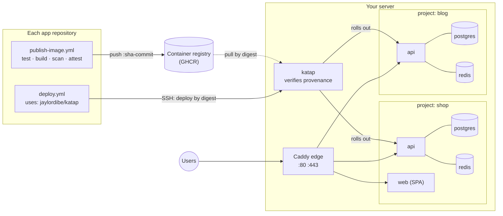

<div align="center">

# Katap

## Many projects. One server. Deployed safely.

Self-hosted deploys for containerized apps on one low-cost VPS —<br>
each project with its own API, database and Redis, behind one HTTPS edge.

[](https://github.com/jaylordibe/katap/actions/workflows/test.yml)


[](LICENSE)

Laravel · NestJS · Angular · React · Vue · Next.js · Nuxt · anything in a container

**[Why&nbsp;Katap](#why-katap)** · **[How&nbsp;it&nbsp;works](#how-it-works)** ·
**[Quick&nbsp;start](#quick-start)** · **[Day&nbsp;to&nbsp;day](#day-to-day)** ·
**[Security](#security-model)** · **[Updating](#updating-katap)** · **[Reference](#reference)**

</div>

---

*Katap* is Cebuano for **spreading out**: one server, and your projects spread
across it, each in its own space.

## Why Katap

Side projects and early products rarely earn an autoscaling cluster, but they
still deserve HTTPS, backups, rollbacks and a database nobody on the internet can
reach. The usual shortcut is one `docker-compose.yml` per app, ports opened by hand,
and `git pull` on the server. It works until a second project needs ports 80 and
443, a migration fails halfway, or a reprovision wipes the data.

Katap is the small, boring layer that makes one server host many projects
properly.

| One compose file per app, by hand | With Katap |
|---|---|
| Each app fights for 80/443 | **One Caddy edge** routes every domain, with automatic HTTPS |
| Databases and Redis published "just for now" | **Only the edge publishes a port.** Each project's data stays on its own private network |
| `git pull` and rebuild on the server | **Images built and scanned in CI**, deployed by immutable digest |
| A failed migration leaves a half-deployed app | **Dump → migrate → roll out → smoke check**, rolling back automatically on failure |
| Backups are a cron line someone meant to add | **Nightly and pre-deploy dumps**, with a restore that puts the matching release back too |
| A CI key that can do anything on the box | **One SSH key per app**, able to deploy only that app's component, and only images the server verified were built by that app's own CI |

**A tool, not a platform.** You clone it onto a server as-is and update it by
checking out a newer release; nothing about your projects lives in it. No
dashboard, no daemon, no database of its own: one Bash CLI, Docker Compose, Caddy
and systemd timers. If you'd rather operate a platform with a UI, Coolify and
Dokku do this job too; Katap is for people who want to read every line that runs
on their server.

## How it works



| | Does | Holds |
|---|---|---|
| **Each application repository** | Tests, builds, scans and publishes its image with a build-provenance attestation (`publish-image.yml`), then asks the server to deploy it (`deploy.yml`, using the Katap action) | Push access to its own image; its own deploy key, in its own GitHub environments |
| **The server** | Holds every project's definition (`/srv/projects`) and secrets, verifies each image's provenance against those definitions, then pulls it by digest and deploys it | A read-only GitHub token; read access to images |

The server decides what may run. Each app's key can only name its own
component, and the server deploys nothing it cannot trace to that app's own
publish workflow, whoever holds the key.

A **project** is a set of **components**, and a component is a container image.
Katap doesn't care what built it. It ships templates for:

| Template | For | Brings its own |
|---|---|---|
| `laravel-api` | [jaylordibe/laravel-api](https://github.com/jaylordibe/laravel-api) and forks | API, Horizon worker, scheduler, PostgreSQL (TLS), Redis |
| `nestjs-api` | [jaylordibe/nestjs-api](https://github.com/jaylordibe/nestjs-api) and forks | API with in-process queue worker, migrate image, PostgreSQL, Redis |
| `spa` | Angular, React, Vue, … built to static files | — |
| `node-ssr` | Next.js, Nuxt, SvelteKit, Remix, … | — |

`katap add` copies a template into the project, so each project can change memory
limits or add a worker without affecting the others.

### What a deploy does

Every step either succeeds or leaves the current release serving.

| Step | What happens | If it fails |
|---|---|---|
| **Admit** | The key's forced command allows only its own component; one dispatch of a component at a time, and not again within a minute of the last | Refused; nothing changed |
| **Validate** | The digest belongs to the component's `image=`; no required secret is blank | Refused; nothing changed |
| **Verify** | `gh attestation verify`: built by the component's `source_repo`'s `publish-image.yml`, from `main` for production; runtime and migrate images from one commit | Refused; nothing changed |
| **Pull** | `docker pull` by digest | Nothing changed |
| **Dump** | `pg_dump` of the component's database, kept with the nightly dumps | Refused; nothing changed |
| **Migrate** | One-shots in order — Laravel: `migrate`, then `permissions`; Nest: the migrate image (Prisma deploy + RBAC sync) | The current release keeps serving |
| **Roll out** | Services recreated in order (Laravel: worker, then API), waiting for each healthcheck; Caddy holds requests across the swap | **Automatic rollback** to the previous release |
| **Smoke check** | An HTTP check from inside the project network: 200, the expected body, no redirects followed | **Automatic rollback** |
| **Record** | The release joins the project's history | — |

The action then checks the public URL with the same smoke check. The deploy runs
detached on the server, so a cancelled workflow or a dropped connection never
stops it halfway; its log is in `/srv/state/.dispatch/<project>/`.

<details>
<summary><b>What a deploy looks like</b> — illustrative shape, not captured output</summary>

```text
Actions → Deploy → production · tag main          (in the shop-api repository)

  ── waits for a production reviewer ──
  resolve     ghcr.io/you/shop-api:main → sha256:9f2c…
  ssh         deploy shop api ghcr.io/you/shop-api@sha256:9f2c…
  verify      built by you/shop-api at 1a2b3c4d5e6f (publish-image.yml @ main)
  pull        ghcr.io/you/shop-api@sha256:9f2c…
  dump        /srv/backups/shop/api-20261014T091005Z-predeploy.dump
  migrate     migrate ✓  permissions ✓
  roll out    api-worker ✓ healthy   api ✓ healthy
  smoke       GET /api/health/ready → 200 "ready"
  record      shop/api is now sha256:9f2c…
  public      https://api.shop.com/api/health/ready → 200
```

</details>

## Is one server right for you?

Yes, for side projects, internal tools and low-traffic products. Know the two
costs:

- **Shared fate.** One server down means every project is down. Backups make
  that recoverable; nothing here makes it highly available.
- **Memory is the limit.** Approximate steady state per component:

  | Component | RAM |
  |---|---|
  | laravel-api API (php-fpm, up to 20 workers in the base image) | 150 MB idle, up to ~1 GB (`mem_limit`) |
  | laravel-api Horizon worker | 100–300 MB |
  | nestjs-api | 150–400 MB |
  | PostgreSQL / Redis, per project | 50–100 MB / ~10 MB |
  | spa / Caddy | ~10 MB / ~30 MB |

  A 4 GB VPS holds two or three small projects. Lower `mem_limit` in a project's
  compose file to fit more. When a project outgrows its share, move it to its own
  server or a managed database: its images and settings go with it unchanged.

## Quick start

In the commands below, `<you>` is your GitHub account or organisation, and
`<server>` is your server's address.

### What you need

- **A server:** a fresh Ubuntu 24.04 or Debian 12 VPS with a public IPv4 address
  and your SSH key, sized with the [memory table](#is-one-server-right-for-you)
  above.
- **A domain** whose DNS you can edit.
- **Each application** in a GitHub repository that can publish its image to a
  registry (GHCR by default).

### 1. Install Katap on the server

```bash
sudo apt-get update && sudo apt-get install -y git
sudo git clone --branch v1.0.0 https://github.com/jaylordibe/katap.git /srv/katap
sudo /srv/katap/host/provision.sh --harden-ssh
```

Use the [latest release](https://github.com/jaylordibe/katap/releases) in place of
`v1.0.0`; never run a server from `main`.

`provision.sh` installs Docker with log rotation, the GitHub CLI, a firewall (22, 80,
443), unattended security upgrades, a swap file, the `deploy` user and the timers,
writes this server's edge settings to `/srv/edge/edge.env`, then starts the edge. It is safe to run again: it never touches project data,
secrets or running containers. `--harden-ssh` turns off password login; it refuses
unless an authorised SSH key already exists for you or root, so it cannot lock you
out.

Then give the server a GitHub token to verify images with. Create a
[fine-grained token](https://github.com/settings/personal-access-tokens/new) with
**read-only access to public repositories** (or **Attestations: read** on private
ones), and put it in `/etc/katap/katap.env`:

```bash
sudo nano /etc/katap/katap.env      # KATAP_GH_TOKEN=github_pat_…
```

If your images are private, also log the deploy user in to the registry with a
token that can only read packages:
`sudo -u deploy docker login ghcr.io -u <you> --password-stdin`.

### 2. Define a project

On the server, as the deploy user:

```bash
sudo -iu deploy
cd /srv/katap
bin/katap add shop laravel-api api api.shop.com
bin/katap add shop spa web shop.com www.shop.com
```

This writes `/srv/projects/shop/`. In each component's `.conf` there, set:

| Key | Value |
|---|---|
| `image=` | The image repository, e.g. `ghcr.io/<you>/shop-api` |
| `source_repo=` | The GitHub repository that builds it, e.g. `<you>/shop-api` |
| `image_migrate=` | nestjs-api only: `ghcr.io/<you>/shop-api-migrate` |
| `environment=` | `production` (default) or `staging`. A staging copy is its own project, e.g. `shop-staging` |

Then generate its secrets, once per component, and fill in what only you know:

```bash
bin/katap secrets shop api     # APP_KEY, Passport keys, database and Redis passwords
bin/katap secrets shop web
nano /srv/secrets/shop/api.env # every value marked '# katap:required': frontend URL, CORS, mail…
bin/katap check shop
bin/katap edge reload          # serve the new domains
```

`katap secrets` never overwrites existing files, and a deploy refuses while a
required value is empty. Point each domain's **A record** at the server (no AAAA
record: the edge is IPv4 only); Caddy obtains the certificate on the first request.

### 3. Give each application its deploy key

For each application repository and environment, create a key **on your machine**:

```bash
ssh-keygen -t ed25519 -N '' -f shop-api-production
```

and authorise its public half **on the server**, bound to that one component:

```bash
sudo /srv/katap/host/provision.sh --ci-key "ssh-ed25519 AAAA… shop-api-production" \
    --ci-env production --ci-project shop --ci-component api
```

That key can now deploy or roll back `shop/api` in production, and nothing else.

### 4. Publish and deploy from the application repository

In the application repository:

1. **Publish.** `laravel-api` and `nestjs-api` already ship
   `.github/workflows/publish-image.yml`. For anything else, copy
   [`examples/publish-image.yml`](examples/publish-image.yml) to that exact path:
   the server checks the attestation came from it. Set the repository variable
   `PUBLISH_ENABLED=true`.
2. **Deploy.** Copy [`examples/deploy.yml`](examples/deploy.yml) to
   `.github/workflows/deploy.yml`, and replace the all-zero commit with the commit
   of the Katap release you run (see [Securing the deploy path](#securing-the-deploy-path)).
3. **Configure** the `production` and `staging` environments as that file's header
   lists: the secrets `KATAP_HOST`, `KATAP_SSH_KEY` (the whole private key file from
   step 3) and `KATAP_KNOWN_HOSTS`, and the variables `KATAP_PROJECT`,
   `KATAP_COMPONENT` and `KATAP_IMAGE`; a nestjs-api also needs
   `KATAP_MIGRATE_IMAGE`, and `KATAP_URL` adds a public check after each deploy. Get `KATAP_KNOWN_HOSTS` on the server itself:
   `ssh-keyscan -t ed25519 localhost | sed "s/^localhost/<server>/"`. Then delete
   the private key from your machine.

A push to `staging` now publishes and deploys to staging: the example's
`workflow_run` trigger must list your publish workflow's exact `name:`, and
`deploy.yml` must be on the default branch, where GitHub reads `workflow_run`
triggers. For production:
**Actions → Deploy → Run workflow → production**, and a reviewer approves.

**First deploy only:**

- **laravel-api:** create the Passport personal access client, which sign-in needs:
  ```bash
  bin/katap run shop api-artisan passport:client --personal --name='API Personal Access Client' --provider=users --no-interaction
  ```
  Never run `db:seed` or `UserSeeder` in production: it creates test users with a
  published password.
- **nestjs-api:** for a component named `api`, `bin/katap run shop api-migrate yarn prisma:seed`
  creates the admin from `SEED_ADMIN_*`.

## Securing the deploy path

The server already refuses anything an app's key is not bound to, and any image it
cannot trace to that app's own publish workflow. What it cannot see is who
approved a deploy, so each application repository protects its own:

1. **Pin the Katap action by commit**, never by a tag:
   `uses: jaylordibe/katap@<40-character commit> # v1.0.0`. The action receives the
   deploy key, and a tag can be moved. It runs no other action, so that commit is
   all the code it runs. Dependabot can propose newer commits; merge one only
   after your server runs that release (see [Updating Katap](#updating-katap)).
2. **Required reviewers on `production`**, with "Prevent self-review" on, and
   deployment branches limited to `main`.
3. **A ruleset on `main`**: require a pull request, block force pushes, no bypass.
   Whoever can change the deploy workflow on `main` can use the key.

**Private application repositories.** Attestations need a public repository or a
GitHub plan that offers them on private ones (set `ATTEST_PROVENANCE=true` in the
publish workflow). Without them, set `provenance=none` in the component's `.conf`:
the server then deploys anything pushed to that image repository, and logs a
warning on every deploy.

## Day to day

Run on the server as the deploy user (`sudo -iu deploy`), from `/srv/katap`.

| Task | Command |
|---|---|
| Roll back | `bin/katap rollback shop api` — to the release before the one serving; run again to go further back. Never runs migrations backwards, so keep migrations expand-only |
| One-off command | `bin/katap run shop api-artisan <args>` — as the application user, never root |
| Logs / status | `docker compose -p shop logs -f api` · `docker compose -p shop ps` |
| Back up now | `bin/katap backup shop` — nightly by timer; keeps 14 of each kind per component (`KATAP_BACKUP_KEEP`) |
| Off-server copies | Install rclone and set `KATAP_RCLONE_REMOTE=remote:bucket/path` in `/etc/katap/katap.env`; use an rclone `crypt` remote, because dumps hold personal data |
| Restore | `bin/katap restore shop api /srv/backups/shop/<file>.dump --confirm shop` |
| Add a domain / change a site | Edit `/srv/projects/<project>/site.caddy`, then `bin/katap edge reload` |
| Change the TLS mode or edge address | Set it in `/srv/edge/edge.env` (it overrides `edge/edge.env` key by key), then `bin/katap edge up` |
| Scheduled work | Each project's per-minute run is cut off after 10 minutes (`KATAP_CRON_TIMEOUT`); put long work on the queue |

Your projects live in `/srv/projects`, outside the tool: back that directory up
with `/srv/secrets`, or keep it in a repository of your own. Never edit files in
`/srv/katap`: a deploy refuses to run while the tool has local modifications.

### Restoring

`restore` puts back the database **and the release that was serving when the dump
was taken**. It stops the component, dumps the current data first, restores into a
new database and swaps it in only when complete, so a failed restore changes
nothing. It also empties the component's Redis, whose queued jobs and caches
described the replaced data.

> [!IMPORTANT]
> **Test a restore before you need one.** A backup that has never been restored is
> a hope, not a backup. Keep a copy of `/srv/secrets` somewhere safe as well: a
> dump without its `APP_KEY` cannot decrypt what the application encrypted.

<details>
<summary><b>Upgrading PostgreSQL to a new major version</b></summary>

Never with the application serving in between:

1. `docker compose -p <project> stop <component> <component>-worker`;
2. `bin/katap backup <project>`;
3. change the image in `/srv/projects/<project>/<component>.yml`;
4. `docker volume rm <project>_<component>-db`;
5. `docker compose -p <project> up -d <component>-db` (the database alone);
6. `bin/katap restore <project> <component> <that dump> --confirm <project>`, which
   restores the data and starts the release again.

The database refuses to start an empty cluster beside an old one, so a forgotten
step stops the database rather than serving an empty one.

</details>

## Security model

| Concern | How Katap handles it |
|---|---|
| **Exposure** | Only 22, 80 and 443 are open, and only Caddy publishes. Each project's database and Redis sit on that project's private network; another project cannot even resolve their names |
| **Secrets** | Generated once on the server, mode 0600, never in git, never regenerated. The database superuser password is readable only by the database container; the app connects as a non-superuser role that owns its database |
| **Supply chain** | Images are scanned in CI and deployed by digest. **The server verifies each image's build provenance itself**, against its own project settings, before pulling anything. Caddy, PostgreSQL, Redis and the smoke-check image are pinned by digest |
| **Deploy keys** | One per application and environment: `restrict,command="katap ssh-dispatch <environment> <project> <component>"`. It can deploy its own component, or roll it back to a release this server has served, with validated arguments, one at a time, and nothing else. Each dispatch is logged with the key's binding and the client address |
| **Destructive operations** | None are automated. Nothing drops a volume, regenerates a key or runs a fresh migration. `restore` is human-only, needs `--confirm`, and dumps first |

**Known limits** — accepted as residual risk:

- **Approval lives in each application repository.** The server bounds *what* can
  deploy (that app's attested builds, `main` for production), not *who approved it*.
  Any attested build of `main` qualifies, including an older one: a key holder can
  move a component back to an earlier `main` build, migrations included.
- **Components of one project share its lock.** A deploy key can delay the other
  components of its own project (by at most one deploy at a time, a minute apart,
  however many components it is bound to), never another project's. Keep staging
  in its own project.
- **The server holds a GitHub token.** Keep it read-only and fine-grained.
- **IPv4 only.** The edge publishes no IPv6 port; publish no AAAA record.
- **The `deploy` user is root-equivalent** through the `docker` group. Protect its keys.
- **Public components share the edge network**, so one project's public service
  could call another's directly, and a laravel-api trusts any address there to set
  the client IP. Databases stay unreachable.
- **laravel-api's database link uses `sslmode=require`:** encrypted, certificate not
  verified. The traffic never leaves the server.
- **Have a person review the deploy path** before trusting it with real data.
  Automated tests do not replace that review.

## Updating Katap

**Upgrade the server first, then the applications.** The action and the server
speak through one request (`deploy <project> <component> <digest> [migrate=<digest>]`);
a server accepts requests from actions of its own release and earlier releases of
the same major version, and refuses anything it does not recognise, loudly. On the
server:

```bash
cd /srv/katap
sudo -u deploy git fetch --tags
sudo -u deploy git checkout v1.1.0       # the release you are moving to
sudo /srv/katap/host/provision.sh        # if the release notes say so
```

Your projects, secrets and data are outside the tool, so a release replaces only
Katap itself. Read the release notes first: a change to a template affects only
projects added after it, and a change to `edge/` takes effect at
`bin/katap edge up`. Then update the action's pinned commit in each application
repository to the same release.

## Contributing

Issues and pull requests are welcome at
[jaylordibe/katap](https://github.com/jaylordibe/katap). Run `tests/run.sh`
before opening a pull request, and `E2E=1 tests/run.sh` for anything that
changes a deploy.

## Reference

### Layout

```text
bin/katap                      the CLI (bash 5; runs on the server)
action.yml, action/            the deploy action applications use
edge/                          the shared Caddy: compose.yml, Caddyfile, edge.env (defaults)
templates/<type>.*             compose file, deploy settings, secret spec and site block per type
host/provision.sh              prepares a server; host/systemd/ holds its timers
lib/                           smoke check, PostgreSQL entrypoint, TLS and app role
examples/                      publish-image.yml and deploy.yml for application repositories
tests/                         static, unit and end-to-end tests
```

On the server: `/srv/katap` (the tool), `/srv/projects/<project>/` (your project
definitions), `/srv/secrets/<project>/` (0700), `/srv/state/<project>/` (what is
serving, and the history), `/srv/backups/<project>/`, `/srv/edge/` (this host's
`edge.env` and Cloudflare certificates), and `/etc/katap/katap.env` (host settings).

### The project contract

`katap check` enforces it, and `katap deploy` refuses a project that breaks it:

- **No `ports:` anywhere.** Docker-published ports bypass the firewall, so this is
  what keeps databases off the internet.
- **Every image pinned by digest.** Application images come from the deploy, as
  `${IMAGE_<COMPONENT>}`.
- **Every long-running service has a healthcheck**, which the rollout and the
  automatic rollback rely on.
- **One-shot services** sit in the `predeploy`, `cron` or `tools` profile and never
  restart.
- **Databases never join the edge network.**
- **Never privileged**, host networking, the host PID namespace or the Docker socket.
- **No fixed `hostname:`**, and every service a `.conf` names exists.

### What each template expects from an image

- **spa** — serves the built files on port 80, answering unknown paths with
  `index.html`, and contains `wget` (`nginx:alpine` or `caddy:alpine` with a
  `try_files … /index.html` rule both do). The API URL is usually baked in at build
  time, so pass it as a build argument.
- **node-ssr** — listens on `0.0.0.0:3000`, answers `/` with 200, and contains `wget`
  (any alpine Node image does). Runtime variables go in
  `/srv/secrets/<project>/<component>.env`.
- **laravel-api / nestjs-api** — their own `Dockerfile` and `publish-image.yml`, as
  shipped.

### TLS modes — `TLS_MODE` in `/srv/edge/edge.env`

| Mode | Use | Needs |
|---|---|---|
| `acme` (default) | Let's Encrypt, issued and renewed automatically | Ports 80 and 443 reaching the server |
| `cloudflare` | Behind Cloudflare's proxy; only Cloudflare's ranges may connect, which is what makes `CF-Connecting-IP` trustworthy | `origin.pem`, `origin.key` and `cf-origin-pull-ca.pem` in `/srv/edge/certs`; SSL mode Full (strict); Authenticated Origin Pulls on |
| `internal` | Local testing only | — |

After switching to or from `cloudflare`, update a nestjs-api's
`TRUST_CLOUDFLARE_HEADERS` by hand: it reflects the mode at the time its secrets
were generated.

### Trusted proxies

Every request reaches an application from Caddy's fixed address on the edge
network (`CADDY_IP`), and Caddy replaces any client-sent `X-Forwarded-For` with the
address it actually saw.

- **nestjs-api** trusts exactly `CADDY_IP` (`TRUST_PROXY`).
- **laravel-api** gets `TRUSTED_PROXIES=0.0.0.0/0`, deliberately: its base image's
  nginx and Laravel parse that variable differently, and one all-addresses CIDR is
  the only value both accept while keeping the real client address and HTTPS
  detection. Nothing outside the server can reach the API container.

### Troubleshooting

| Symptom | Likely cause | Check |
|---|---|---|
| Deploy refused: required values are empty | A `# katap:required` value is blank | `/srv/secrets/<project>/<component>.env` |
| Deploy refused: could not verify that … was built by … | Not built by `source_repo`'s `publish-image.yml`, not from an allowed branch, or the repository publishes no attestations; the `gh said:` part tells which | `source_repo=` in the `.conf`; the publish run; `provenance=none` for private repos without attestations |
| Deploy refused: set `KATAP_GH_TOKEN` | The server has no GitHub token | `/etc/katap/katap.env` |
| Deploy refused: this key deploys … only | The app's key is bound to another project or component | `provision.sh --ci-project/--ci-component`; the workflow's `KATAP_PROJECT`/`KATAP_COMPONENT` |
| Deploy refused: this key names no project and component | The key was authorised before keys were bound to a component | Run `provision.sh --ci-key … --ci-project … --ci-component …` again for it |
| Deploy refused: already running, or dispatched less than 60s ago | Another deploy by that key or of that component is in progress, or one just finished | Wait, then re-run; its log is in `/srv/state/.dispatch/<project>/` |
| Deploy refused: … gh said: HTTP 401 (or another gh error) | The server's `KATAP_GH_TOKEN` expired or lacks access | A new token in `/etc/katap/katap.env` |
| Deploy refused: GitHub did not answer | GitHub's API was unreachable within 60s (`KATAP_GH_TIMEOUT`) | Retry; check the server's outbound network |
| Deploy refused: built from different commits | The runtime and migrate images come from different publish runs | Deploy one tag that names both |
| Deploy refused: has local modifications | Files under `/srv/katap` were edited | `git -C /srv/katap status`; check out the release again |
| Action fails: is not on ghcr.io / known-hosts is empty | The image is on another registry, or the `KATAP_KNOWN_HOSTS` secret is missing | Set the action's `registry` input; add the secret |
| Deploy fails and rolls back | The new release never became healthy, or failed its smoke check | `docker compose -p <project> logs --tail=200 <service>` |
| `502` from the edge | The upstream container is down or unhealthy | `docker compose -p <project> ps` |
| No certificate (acme) | DNS not pointing at the server yet, or 80/443 blocked upstream | `docker compose -p katap-edge logs caddy` |
| `525` / `526` from Cloudflare | Origin certificate missing or wrong, or Authenticated Origin Pulls off | `ls -l /srv/edge/certs`, the Cloudflare dashboard |
| Every client shares one IP | The application does not trust the edge's address | nestjs-api: `TRUST_PROXY` = `CADDY_IP`; laravel-api: `TRUSTED_PROXIES=0.0.0.0/0` |
| API logs `ECONNREFUSED` to its database | The database is still starting | `docker compose -p <project> logs <component>-db` |
| Disk filling up | Old images | `docker image prune` (logs are already capped) |

### Testing Katap

```bash
tests/run.sh          # shellcheck, the contract, secrets, provenance, ssh-dispatch, the action, provisioning, smoke check, edge
E2E=1 tests/run.sh    # plus a real deploy on local Docker: build laravel-api, deploy, roll back, back up, restore
```

Both run inside a pinned Linux container (`tests/runner.Dockerfile`), so a Mac's
bash 3.2 behaves exactly like the server.

---

<div align="center">

**Your projects, spread across one server — each in its own space.**

MIT licensed · see [LICENSE](LICENSE)

</div>
