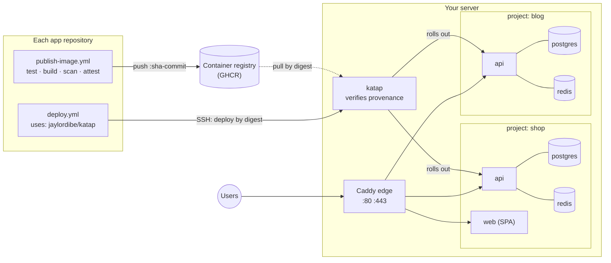

<div align="center">

# Katap

## Many projects. One server. Deployed safely.

Self-hosted deploys for containerized apps on one low-cost VPS —<br>
each project with its own API, database and Redis, behind one HTTPS edge.

[](https://github.com/jaylordibe/katap/actions/workflows/test.yml)
[](https://github.com/jaylordibe/katap/releases/latest)


[](LICENSE)

Laravel · NestJS · Angular · React · Vue · Next.js · Nuxt · anything in a container

**[Why&nbsp;Katap](#why-katap)** · **[Quick&nbsp;start](#quick-start)** ·
**[How&nbsp;it&nbsp;works](#how-it-works)** · **[Security](#security-in-short)** ·
**[Docs](#documentation)** · **[Development](#development)**

</div>

---

*Katap* is Cebuano for **spreading out**: one server, and your projects spread
across it, each in its own space.

## Why Katap

Side projects and early products rarely earn an autoscaling cluster, but they
still deserve HTTPS, backups, rollbacks and a database nobody on the internet can
reach. The usual shortcut is one `docker-compose.yml` per app, ports opened by hand,
and `git pull` on the server. It works until a second project needs ports 80 and
443, a migration fails halfway, or a reprovision wipes the data.

### Highlights

- **Three commands from a fresh VPS to deploying apps:** install the server, describe your projects in one file, connect your repositories.
- **One Caddy edge** routes every domain, with automatic HTTPS. Only the edge publishes a port; each project's database and Redis stay on its own private network.
- **Images built and scanned in CI**, deployed by immutable digest. Each is deployed only after the server itself has verified it was built by that app's own publish workflow.
- **Dump → migrate → roll out → smoke check**, rolling back automatically when the new release never becomes healthy.
- **Nightly and pre-deploy dumps**, with a restore that puts the matching release back too.
- **One deploy key per app,** able to deploy only that app's component. Each app's own GitHub Actions does the deploying, with production approval in that repository.
- **A tool, not a platform.** No dashboard, no daemon, no database of its own: one Bash CLI, Docker Compose, Caddy and systemd timers. If you'd rather operate a platform with a UI, Coolify and Dokku do this job too.

## Quick start

You need:

- a fresh **Ubuntu 24.04 or Debian 12 VPS** with a public IPv4 address, sized with the [memory table](docs/operations.md#is-one-server-enough);
- a **domain** whose DNS you can edit;
- each app in a **GitHub repository** that publishes its image. `laravel-api` and `nestjs-api` forks already do; others copy [`examples/publish-image.yml`](examples/publish-image.yml).

**1. Install the server**

```bash
curl -fsSL https://raw.githubusercontent.com/jaylordibe/katap/main/install.sh | sudo bash
```

This installs the latest release at `/srv/katap`, along with:

- Docker, the GitHub CLI and a firewall (22, 80, 443);
- unattended security upgrades, swap, and the `deploy` user;
- backup timers and the edge.

It asks for a [fine-grained GitHub token](https://github.com/settings/personal-access-tokens/new)
with **read-only access to public repositories**. The server uses it to check where
each image came from. For an unattended install, `export KATAP_GH_TOKEN=…` and pipe
into `sudo --preserve-env=KATAP_GH_TOKEN bash` instead. Running it again upgrades.
Add `-s -- --harden-ssh` to turn off password login.

**2. Describe your projects, then apply**

```bash
sudo nano /srv/katap.json
```

```json
{
  "host": "203.0.113.10",
  "projects": {
    "shop": {
      "api": { "type": "laravel-api", "repo": "you/shop-api", "domains": ["api.example.com"] },
      "web": { "type": "spa",         "repo": "you/shop-web", "domains": ["example.com", "www.example.com"] }
    }
  }
}
```

Put in your own server address, repositories and domains: `you/…` and `example.com`
are placeholders.

```bash
sudo -u deploy /srv/katap/bin/katap apply
```

Apply creates each project and generates its secrets. It fills in what it can work
out: here, the API's frontend URL and CORS origins, from `web`. Then it prints:

- the DNS records to add;
- the few values only you know, such as mail settings in `/srv/secrets/shop/api.env`;
- the command for step 3.

**3. Connect your repositories, from your own computer**

```bash
curl -fsSL https://raw.githubusercontent.com/jaylordibe/katap/main/connect.sh | bash -s -- root@203.0.113.10
```

It uses your own `ssh` and `gh` logins and asks before changing anything. For every
app, it:

- makes and authorises a deploy key bound to that component;
- sets up the repository's GitHub environment;
- prints the one command that adds the deploy workflow, pinned to the server's release.

Run that command in each repository and commit the file, then add required
reviewers to the `production` environment.

That's it. A push to `main` publishes the image. Deploy it from **Actions → Deploy
→ Run workflow → production**, or let `staging` deploy after every publish. The
first deploy of a laravel-api also needs its
[Passport client](docs/connecting-apps.md#first-deploy-only).

> [!TIP]
> Adding a project later takes the same steps: add it to `/srv/katap.json`, run
> `katap apply`, then run `connect.sh` again. It skips everything already connected.

## How it works



A **project** is a set of **components**, and a component is a container image.
Katap ships templates for:

| Template | For | Brings its own |
|---|---|---|
| `laravel-api` | [jaylordibe/laravel-api](https://github.com/jaylordibe/laravel-api) and forks | API, Horizon worker, scheduler, PostgreSQL (TLS), Redis |
| `nestjs-api` | [jaylordibe/nestjs-api](https://github.com/jaylordibe/nestjs-api) and forks | API with in-process queue worker, migrate image, PostgreSQL, Redis |
| `spa` | Angular, React, Vue, … built to static files | — |
| `node-ssr` | Next.js, Nuxt, SvelteKit, Remix, … | — |

The server decides what may run. Each app's key can only name its own component.
The server deploys nothing it cannot trace to that app's own publish workflow,
whoever holds the key. Every deploy either succeeds or leaves the current release
serving; see [what a deploy does](docs/operations.md#what-a-deploy-does).

**Is one server right for you?** Yes, for side projects, internal tools and
low-traffic products. One server down means every project is down: backups make
that recoverable, but nothing here makes it highly available. A 4 GB VPS holds two
or three small projects.

## Security in short

- **Only the edge is reachable.** Databases and Redis never leave their project's network.
- **Secrets are generated on the server**, once, mode 0600. They are never in git and never in `katap.json`.
- **The server verifies provenance itself:** an image deploys only if GitHub attests it was built by its repository's `publish-image.yml`, from `main` for production.
- **Deploy keys are bound** to one component and environment, and can only deploy or roll back.
- **Nothing destructive is automated:** no dropped volumes, no regenerated keys, no fresh migrations. `apply` never removes anything.

The full model and its known limits are in [docs/security.md](docs/security.md).
Have a person review the deploy path before trusting it with real data.

## Documentation

| Topic | |
|---|---|
| [The projects file and `katap apply`](docs/projects-file.md) | Every key of `katap.json`, what apply creates, and what stays yours to edit |
| [Connecting applications](docs/connecting-apps.md) | What `connect.sh` does, finishing in GitHub, private repositories, and doing it by hand |
| [Day to day](docs/operations.md) | Rollback, backups, restore, logs, sizing, and what a deploy does |
| [Updating Katap](docs/updating.md) | Upgrading the server and moving each app's pinned action |
| [Security model](docs/security.md) | What each control protects, and the known limits |
| [Reference](docs/reference.md) | Layout, the project contract, image expectations, TLS modes, trusted proxies |
| [Troubleshooting](docs/troubleshooting.md) | Each refusal, what causes it and what to check |

## Development

```bash
tests/run.sh          # static and unit tests, in a pinned Linux container
E2E=1 tests/run.sh    # plus a real deploy on local Docker
```

Issues and pull requests are welcome. Run `tests/run.sh` before opening a pull
request, and `E2E=1 tests/run.sh` for anything that changes a deploy.

---

<div align="center">

**Your projects, spread across one server — each in its own space.**

MIT licensed · see [LICENSE](LICENSE)

</div>
