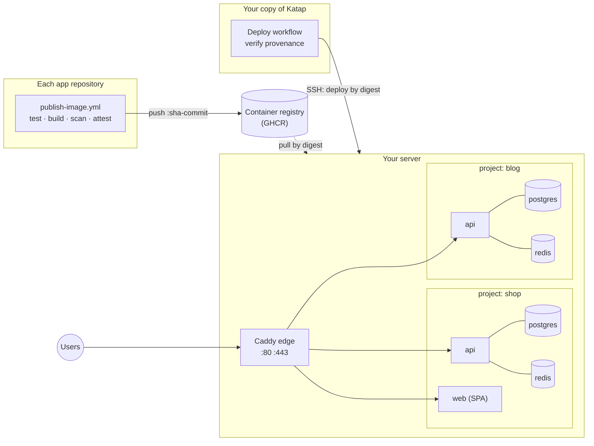

<div align="center">

# Katap

## Many projects. One server. Deployed safely.

Self-hosted deploys for containerized apps on one low-cost VPS —<br>
each project with its own API, database and Redis, behind one HTTPS edge.

[](https://github.com/jaylordibe/katap/actions/workflows/test.yml)


[](LICENSE)

Laravel · NestJS · Angular · React · Vue · Next.js · Nuxt · anything in a container

**[Why&nbsp;Katap](#why-katap)** · **[How&nbsp;it&nbsp;works](#how-it-works)** ·
**[Quick&nbsp;start](#quick-start)** · **[Day&nbsp;to&nbsp;day](#day-to-day)** ·
**[Security](#security-model)** · **[Updating](#updating-katap)** · **[Reference](#reference)**

</div>

---

*Katap* is Cebuano for **spreading out**: one server, and your projects spread
across it, each in its own space.

## Why Katap

Side projects and early products rarely earn an autoscaling cluster, but they
still deserve HTTPS, backups, rollbacks and a database nobody on the internet can
reach. The usual shortcut is one `docker-compose.yml` per app, ports opened by hand,
and `git pull` on the server. It works until a second project needs ports 80 and
443, a migration fails halfway, or a reprovision wipes the data.

Katap is the small, boring layer that makes one server host many projects
properly.

| One compose file per app, by hand | With Katap |
|---|---|
| Each app fights for 80/443 | **One Caddy edge** routes every domain, with automatic HTTPS |
| Databases and Redis published "just for now" | **Only the edge publishes a port.** Each project's data stays on its own private network |
| `git pull` and rebuild on the server | **Images built and scanned in CI**, deployed by immutable digest |
| A failed migration leaves a half-deployed app | **Dump → migrate → roll out → smoke check**, rolling back automatically on failure |
| Backups are a cron line someone meant to add | **Nightly and pre-deploy dumps**, with a restore that puts the matching release back too |
| A CI key that can do anything on the box | **A forced-command SSH key** that can only deploy its own environment's components |

**Not a platform.** No dashboard, no daemon, no database of its own: one Bash
CLI, Docker Compose, Caddy and systemd timers. Your projects are plain files in
this repository, reviewed like any other code. If you'd rather operate a
platform with a UI, Coolify and Dokku do this job too; Katap is for people who want
to read every line that runs on their server.

## How it works



Three parties, three different credentials:

| | Does | Holds |
|---|---|---|
| **Application repository** | Tests, builds, scans and publishes its image with a build-provenance attestation. Never deploys. | Push access to its own image |
| **Your copy of Katap** | Defines your projects (`projects/`) and deploys: the Deploy workflow resolves a tag to a digest, verifies it was attested by that app's own publish workflow, then asks the server to run it. | The SSH key for each environment |
| **The server** | Pulls by digest and runs `katap deploy`. | Read access to images |

A **project** is a set of **components**, and a component is a container image.
Katap doesn't care what built it. It ships templates for:

| Template | For | Brings its own |
|---|---|---|
| `laravel-api` | [jaylordibe/laravel-api](https://github.com/jaylordibe/laravel-api) and forks | API, Horizon worker, scheduler, PostgreSQL (TLS), Redis |
| `nestjs-api` | [jaylordibe/nestjs-api](https://github.com/jaylordibe/nestjs-api) and forks | API with in-process queue worker, migrate image, PostgreSQL, Redis |
| `spa` | Angular, React, Vue, … built to static files | — |
| `node-ssr` | Next.js, Nuxt, SvelteKit, Remix, … | — |

The templates are copied into your project, not referenced, so each project can
change memory limits or add a worker without affecting the others.

### What a deploy does

Every step either succeeds or leaves the current release serving.

| Step | What happens | If it fails |
|---|---|---|
| **Validate** | The digest belongs to the component's `image=`; no required secret is blank | Refused; nothing changed |
| **Pull** | `docker pull` by digest | Nothing changed |
| **Dump** | `pg_dump` of the component's database, kept with the nightly dumps | Refused; nothing changed |
| **Migrate** | One-shots in order — Laravel: `migrate`, then `permissions`; Nest: the migrate image (Prisma deploy + RBAC sync) | The current release keeps serving |
| **Roll out** | Services recreated in order (Laravel: worker, then API), waiting for each healthcheck; Caddy holds requests across the swap | **Automatic rollback** to the previous release |
| **Smoke check** | An HTTP check from inside the project network: 200, the expected body, no redirects followed | **Automatic rollback** |
| **Record** | The release joins the history; the edge reloads | A bad site file is a warning; the release is serving |

The workflow then checks the public URL with the same smoke check. The deploy
runs detached on the server, so a cancelled workflow or a dropped connection
never stops it halfway; its log is in `/srv/state/dispatch/`.

<details>
<summary><b>What a deploy looks like</b> — illustrative shape, not captured output</summary>

```text
Actions → Deploy → production · shop · api · ghcr.io/you/shop-api:main

  ── waits for a production reviewer ──
  resolve     ghcr.io/you/shop-api:main → sha256:9f2c…
  verify      attested by you/shop-api/.github/workflows/publish-image.yml @ main
  pull        ghcr.io/you/shop-api@sha256:9f2c…
  dump        /srv/backups/shop/api-20261014T091005Z-predeploy.dump
  migrate     migrate ✓  permissions ✓
  roll out    api-worker ✓ healthy   api ✓ healthy
  smoke       GET /api/health/ready → 200 "ready"
  record      shop/api is now sha256:9f2c…
  public      https://api.shop.com/api/health/ready → 200
```

</details>

## Is one server right for you?

Yes, for side projects, internal tools and low-traffic products. Know the two
costs:

- **Shared fate.** One server down means every project is down. Backups make
  that recoverable; nothing here makes it highly available.
- **Memory is the limit.** Approximate steady state per component:

  | Component | RAM |
  |---|---|
  | laravel-api API (php-fpm, up to 20 workers in the base image) | 150 MB idle, up to ~1 GB (`mem_limit`) |
  | laravel-api Horizon worker | 100–300 MB |
  | nestjs-api | 150–400 MB |
  | PostgreSQL / Redis, per project | 50–100 MB / ~10 MB |
  | spa / Caddy | ~10 MB / ~30 MB |

  A 4 GB VPS holds two or three small projects. Lower `mem_limit` in a project's
  compose file to fit more. When a project outgrows its share, move it to its own
  server or a managed database: its images and settings go with it unchanged.

## Quick start

Katap is not a service you sign up for: you run **your own copy** of this
repository. Your copy holds your project definitions, and its GitHub
environments hold the keys that deploy to your server, so each person or team
keeps their own. In the commands below, `<you>` is your GitHub account or
organisation, and `<server>` is your server's address.

### What you need

- **A server:** a fresh Ubuntu 24.04 or Debian 12 VPS with a public IPv4 address
  and your SSH key, sized with the [memory table](#is-one-server-right-for-you)
  above.
- **A domain** whose DNS you can edit.
- **On your machine:** git, Docker, `jq`, and **bash 4 or newer**. macOS ships
  bash 3.2, so install a newer one first: `brew install bash jq`.

### 1. Make your copy

Create an **empty** repository named `katap` under your account on GitHub
(public or private; no README, licence or `.gitignore`), then:

```bash
git clone https://github.com/jaylordibe/katap.git && cd katap
git remote rename origin upstream
git remote add origin git@github.com:<you>/katap.git
git push -u origin main
```

Keeping `upstream` lets you [pull in Katap updates](#updating-katap) later. Your
copy holds no secrets, but it does name your domains and image repositories, so
make it private if you'd rather not publish those.

### 2. Prepare the server

On the server:

```bash
sudo apt-get update && sudo apt-get install -y git
```

**If your copy is public**, clone it:

```bash
sudo git clone https://github.com/<you>/katap.git /srv/katap
```

**If your copy is private**, give the server its own read-only key instead.
`provision.sh` reuses a `deploy` user that already exists:

```bash
sudo useradd --create-home --shell /bin/bash deploy
sudo -u deploy ssh-keygen -t ed25519 -N '' -f /home/deploy/.ssh/id_ed25519
sudo cat /home/deploy/.ssh/id_ed25519.pub
# add that key to your copy: Settings → Deploy keys → Add deploy key (leave write access off)
sudo install -d -o deploy -g deploy /srv/katap
sudo -u deploy git clone git@github.com:<you>/katap.git /srv/katap
```

Then, **on your machine**, create one CI key per environment this server will
host:

```bash
ssh-keygen -t ed25519 -N '' -f ci_production
ssh-keygen -t ed25519 -N '' -f ci_staging
```

and, **on the server**, provision it with their public halves (paste the
contents of each `.pub` file):

```bash
sudo /srv/katap/host/provision.sh --ci-key "ssh-ed25519 AAAA… ci_production" --ci-env production --harden-ssh
sudo /srv/katap/host/provision.sh --ci-key "ssh-ed25519 AAAA… ci_staging" --ci-env staging
```

`provision.sh` installs Docker with log rotation, a firewall (22, 80, 443),
unattended security upgrades, a swap file, the `deploy` user and the timers, then
starts the edge. It is safe to run again: it never touches project data, secrets
or running containers. `--harden-ssh` turns off password login; it refuses unless
an authorised SSH key already exists for you or root, so it cannot lock you out. If your images are private, log the
deploy user in to the registry with a token that can only read packages:
`sudo -u deploy docker login ghcr.io -u <you> --password-stdin`.

### 3. Connect GitHub to the server

In your copy on GitHub, follow [Securing the deploy path](#securing-the-deploy-path):
protect `main`, create the `production` and `staging` environments, and add
their secrets. **Do this before the first deploy.** Your copy's Deploy workflow
holds the keys to your server.

### 4. Define a project

On your machine, in your copy:

```bash
bin/katap add shop laravel-api api api.shop.com
bin/katap add shop spa web shop.com www.shop.com
```

In `projects/shop/api.conf` and `web.conf`, set `image=` (`ghcr.io/<you>/shop-api`)
and `source_repo=` (`<you>/shop-api`); a `nestjs-api` also needs `image_migrate=`.
Components are `environment=production` by default; a staging copy is its own
project (`shop-staging`) with `environment=staging`. Run `bin/katap check shop`,
then commit and push to `main`.

### 5. Generate the project's secrets

On the server, as the deploy user, once per component:

```bash
sudo -iu deploy
cd /srv/katap && git pull
bin/katap secrets shop api     # APP_KEY, Passport keys, database and Redis passwords
bin/katap secrets shop web
nano /srv/secrets/shop/api.env # fill every value marked '# katap:required'
```

The required values are the ones only you know, such as the frontend URL, CORS
origins and mail settings. `katap secrets` never overwrites existing files, and
a deploy refuses while a required value is empty.

### 6. Publish your images

In each application repository: `laravel-api` and `nestjs-api` already ship
`.github/workflows/publish-image.yml`. For anything else, copy
[`examples/publish-image.yml`](examples/publish-image.yml) to that exact path
(the deploy checks the attestation came from it). Set the repository variable
`PUBLISH_ENABLED=true`. Every push to `main` or `staging` then pushes
`:sha-<commit>`, scans that digest, attests it, and only then moves `:<branch>`.

### 7. Deploy

Point each domain's **A record** at the server (no AAAA record: the edge is
IPv4 only). Then, in your copy on GitHub: **Actions → Deploy → Run workflow**,
choosing the environment, project, component and image
(`ghcr.io/<you>/shop-api:main`). Caddy obtains the certificate on the first
request.

**First deploy only:**

- **laravel-api:** create the Passport personal access client, which sign-in needs:
  ```bash
  bin/katap run shop api-artisan passport:client --personal --name='API Personal Access Client' --provider=users --no-interaction
  ```
  Never run `db:seed` or `UserSeeder` in production: it creates test users with a
  published password.
- **nestjs-api:** for a component named `api`, `bin/katap run shop api-migrate yarn prisma:seed`
  creates the admin from `SEED_ADMIN_*`.

## Securing the deploy path

Your copy holds the deploy keys, so whoever can change its `main` can deploy
anything to your server. In your copy's settings on GitHub:

1. **A ruleset on `main`** (Settings → Rules): require a pull request, block force
   pushes and deletion, and allow **no bypass** — not even for yourself.
2. **Environments** `production` and `staging` (Settings → Environments), each
   accepting deployments from `main` only.
3. **Required reviewers on production**, so every production deploy is a person
   approving it.
4. **Each environment's secrets:**

   | Secret | Value |
   |---|---|
   | `DEPLOY_HOST` | The server's address |
   | `DEPLOY_USER` | `deploy` |
   | `DEPLOY_SSH_KEY` | The **private** CI key for that environment: the whole contents of `ci_production` or `ci_staging` |
   | `DEPLOY_KNOWN_HOSTS` | The server's host key, taken on the server itself: `ssh-keyscan -t ed25519 localhost \| sed "s/^localhost/<server>/"` |
   | `REGISTRY_READ_TOKEN` | Optional: a token that can read your images, if they are private |
   | `ATTESTATION_READ_TOKEN` | Optional: a token that can read your app repositories' attestations, if those are private |

   Then delete the CI private keys from your machine; GitHub now holds them.

**Optional staging auto-deploy.** An app repository can start a staging deploy
after it publishes: add the dispatch step from
[`examples/publish-image.yml`](examples/publish-image.yml), with a fine-grained
token holding **only Actions: write** on your copy. That token can start the
Deploy workflow but cannot change a file there, and production still waits for
its reviewers.

**Private app repositories.** Attestations need a public repository or a GitHub
plan that offers them on private ones (set `ATTEST_PROVENANCE=true`). Without
them, set `provenance=none` in the component's `.conf`: the Deploy workflow then
trusts anything pushed to that image repository, and says so on every run.

## Day to day

Run on the server as the deploy user (`sudo -iu deploy`), from `/srv/katap`.

| Task | Command |
|---|---|
| Roll back | `bin/katap rollback shop api` — to the release before the one serving; run again to go further back. Never runs migrations backwards, so keep migrations expand-only |
| One-off command | `bin/katap run shop api-artisan <args>` — as the application user, never root |
| Logs / status | `docker compose -p shop logs -f api` · `docker compose -p shop ps` |
| Back up now | `bin/katap backup shop` — nightly by timer; keeps 14 of each kind per component (`KATAP_BACKUP_KEEP`) |
| Off-server copies | Install rclone and set `KATAP_RCLONE_REMOTE=remote:bucket/path` in `/etc/katap/katap.env`; use an rclone `crypt` remote, because dumps hold personal data |
| Restore | `bin/katap restore shop api /srv/backups/shop/<file>.dump --confirm shop` |
| Add a domain / change a site | In your copy: edit `projects/<project>/site.caddy`, commit, push. On the server: `git pull`, `bin/katap edge reload` |
| Change the TLS mode | In your copy: edit `edge/edge.env`, commit, push. On the server: `git pull`, `bin/katap edge up` |
| Scheduled work | Each project's per-minute run is cut off after 10 minutes (`KATAP_CRON_TIMEOUT`); put long work on the queue |

Never edit files in `/srv/katap` on the server: change your copy, push, and
`git pull` on the server. A deploy refuses to run when the server's checkout has
local changes or differs from the commit the workflow ran from.

### Restoring

`restore` puts back the database **and the release that was serving when the dump
was taken**. It stops the component, dumps the current data first, restores into a
new database and swaps it in only when complete, so a failed restore changes
nothing. It also empties the component's Redis, whose queued jobs and caches
described the replaced data.

> [!IMPORTANT]
> **Test a restore before you need one.** A backup that has never been restored is
> a hope, not a backup. Keep a copy of `/srv/secrets` somewhere safe as well: a
> dump without its `APP_KEY` cannot decrypt what the application encrypted.

<details>
<summary><b>Upgrading PostgreSQL to a new major version</b></summary>

Never with the application serving in between:

1. `docker compose -p <project> stop <component> <component>-worker`;
2. `bin/katap backup <project>`;
3. change the image in `projects/<project>/<component>.yml`, commit, pull;
4. `docker volume rm <project>_<component>-db`;
5. `docker compose -p <project> up -d <component>-db` (the database alone);
6. `bin/katap restore <project> <component> <that dump> --confirm <project>`, which
   restores the data and starts the release again.

The database refuses to start an empty cluster beside an old one, so a forgotten
step stops the database rather than serving an empty one.

</details>

## Security model

| Concern | How Katap handles it |
|---|---|
| **Exposure** | Only 22, 80 and 443 are open, and only Caddy publishes. Each project's database and Redis sit on that project's private network; another project cannot even resolve their names |
| **Secrets** | Generated once on the server, mode 0600, never in git, never regenerated. The database superuser password is readable only by the database container; the app connects as a non-superuser role that owns its database |
| **Supply chain** | Images are scanned in CI, deployed by digest, and their build provenance is verified before deploy. Caddy, PostgreSQL, Redis and the smoke-check image are pinned by digest |
| **CI access** | Each CI key is `restrict,command="katap ssh-dispatch <environment>"`: it can deploy, or roll back to a release this server has served, only components of its own environment, with validated arguments, and nothing else |
| **Destructive operations** | None are automated. Nothing drops a volume, regenerates a key or runs a fresh migration. `restore` is human-only, needs `--confirm`, and dumps first |

**Known limits** — accepted as residual risk:

- **IPv4 only.** The edge publishes no IPv6 port; publish no AAAA record.
- **The `deploy` user is root-equivalent** through the `docker` group. Protect its keys.
- **Public components share the edge network**, so one project's public service
  could call another's directly, and a laravel-api trusts any address there to set
  the client IP. Databases stay unreachable.
- **laravel-api's database link uses `sslmode=require`:** encrypted, certificate not
  verified. The traffic never leaves the server.
- **Have a person review the deploy path** before trusting it with real data.
  Automated tests do not replace that review.

## Updating Katap

Your copy keeps this repository as `upstream`. To take a new version:

```bash
git pull upstream main     # your projects/ never conflict: upstream ships it empty
git push origin main       # through a pull request, if main is protected
```

Then `git pull` on the server, because a deploy refuses to run when the server's
checkout differs from the commit the workflow ran from. Read the commit log before
updating: a change to `edge/`, `host/` or a template you copied may need you to
re-run `provision.sh`, `bin/katap edge up`, or edit your project's compose files.

## Contributing

Issues and pull requests are welcome at
[jaylordibe/katap](https://github.com/jaylordibe/katap). Run `tests/run.sh`
before opening a pull request, and `E2E=1 tests/run.sh` for anything that
changes a deploy.

## Reference

### Layout

```text
bin/katap                      the CLI (bash 5; runs on the server)
edge/                          the shared Caddy: compose.yml, Caddyfile, edge.env
templates/<type>.*             compose file, deploy settings, secret spec and site block per type
projects/<project>/            YOUR projects: <component>.yml, <component>.conf, site.caddy (no secrets)
host/provision.sh              prepares a server; host/systemd/ holds its timers
lib/                           smoke check, PostgreSQL entrypoint, TLS and app role
.github/workflows/deploy.yml   the Deploy workflow
examples/publish-image.yml     the publish workflow an application repository copies
tests/                         static, unit and end-to-end tests
```

On the server, under `/srv`: `katap/` (this repository), `secrets/<project>/` (0700,
never in git), `state/<project>/` (what is serving, and the history),
`backups/<project>/`, and `edge/certs/` (Cloudflare mode only).

### The project contract

`katap check` enforces it, and `katap deploy` refuses a project that breaks it:

- **No `ports:` anywhere.** Docker-published ports bypass the firewall, so this is
  what keeps databases off the internet.
- **Every image pinned by digest.** Application images come from the deploy, as
  `${IMAGE_<COMPONENT>}`.
- **Every long-running service has a healthcheck**, which the rollout and the
  automatic rollback rely on.
- **One-shot services** sit in the `predeploy`, `cron` or `tools` profile and never
  restart.
- **Databases never join the edge network.**
- **Never privileged**, host networking, the host PID namespace or the Docker socket.
- **No fixed `hostname:`**, and every service a `.conf` names exists.

### What each template expects from an image

- **spa** — serves the built files on port 80, answering unknown paths with
  `index.html`, and contains `wget` (`nginx:alpine` or `caddy:alpine` with a
  `try_files … /index.html` rule both do). The API URL is usually baked in at build
  time, so pass it as a build argument.
- **node-ssr** — listens on `0.0.0.0:3000`, answers `/` with 200, and contains `wget`
  (any alpine Node image does). Runtime variables go in
  `/srv/secrets/<project>/<component>.env`.
- **laravel-api / nestjs-api** — their own `Dockerfile` and `publish-image.yml`, as
  shipped.

### TLS modes — `edge/edge.env`

| Mode | Use | Needs |
|---|---|---|
| `acme` (default) | Let's Encrypt, issued and renewed automatically | Ports 80 and 443 reaching the server |
| `cloudflare` | Behind Cloudflare's proxy; only Cloudflare's ranges may connect, which is what makes `CF-Connecting-IP` trustworthy | `origin.pem`, `origin.key` and `cf-origin-pull-ca.pem` in `/srv/edge/certs`; SSL mode Full (strict); Authenticated Origin Pulls on |
| `internal` | Local testing only | — |

After switching to or from `cloudflare`, update a nestjs-api's
`TRUST_CLOUDFLARE_HEADERS` by hand: it reflects the mode at the time its secrets
were generated.

### Trusted proxies

Every request reaches an application from Caddy's fixed address on the edge
network (`CADDY_IP`), and Caddy replaces any client-sent `X-Forwarded-For` with the
address it actually saw.

- **nestjs-api** trusts exactly `CADDY_IP` (`TRUST_PROXY`).
- **laravel-api** gets `TRUSTED_PROXIES=0.0.0.0/0`, deliberately: its base image's
  nginx and Laravel parse that variable differently, and one all-addresses CIDR is
  the only value both accept while keeping the real client address and HTTPS
  detection. Nothing outside the server can reach the API container.

### Troubleshooting

| Symptom | Likely cause | Check |
|---|---|---|
| Deploy refused: required values are empty | A `# katap:required` value is blank | `/srv/secrets/<project>/<component>.env` |
| Deploy fails and rolls back | The new release never became healthy, or failed its smoke check | `docker compose -p <project> logs --tail=200 <service>` |
| `502` from the edge | The upstream container is down or unhealthy | `docker compose -p <project> ps` |
| No certificate (acme) | DNS not pointing at the server yet, or 80/443 blocked upstream | `docker compose -p katap-edge logs caddy` |
| `525` / `526` from Cloudflare | Origin certificate missing or wrong, or Authenticated Origin Pulls off | `ls -l /srv/edge/certs`, the Cloudflare dashboard |
| Every client shares one IP | The application does not trust the edge's address | nestjs-api: `TRUST_PROXY` = `CADDY_IP`; laravel-api: `TRUSTED_PROXIES=0.0.0.0/0` |
| API logs `ECONNREFUSED` to its database | The database is still starting | `docker compose -p <project> logs <component>-db` |
| Disk filling up | Old images | `docker image prune` (logs are already capped) |

### Testing Katap

```bash
tests/run.sh          # shellcheck, the contract, secrets, refusals, ssh-dispatch, smoke check, edge config
E2E=1 tests/run.sh    # plus a real deploy on local Docker: build laravel-api, deploy, roll back, back up, restore
```

Both run inside a pinned Linux container (`tests/runner.Dockerfile`), so a Mac's
bash 3.2 behaves exactly like the server.

---

<div align="center">

**Your projects, spread across one server — each in its own space.**

MIT licensed · see [LICENSE](LICENSE)

</div>
