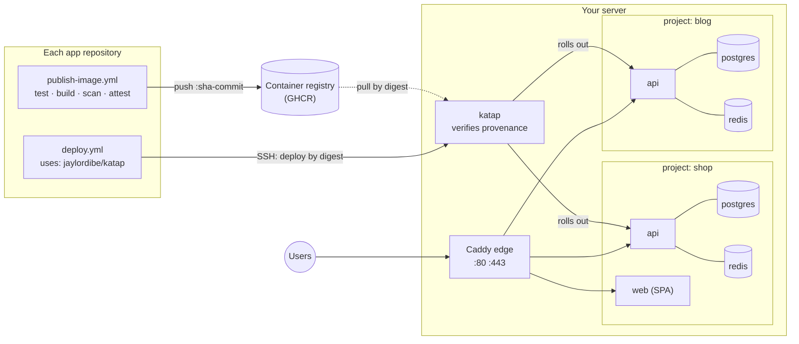

<div align="center">

# Katap

## Many projects. One server. Deployed safely.

Self-hosted deploys for containerized apps on one low-cost VPS —<br>
each project with its own API, database and Redis, behind one HTTPS edge.

[](https://github.com/jaylordibe/katap/actions/workflows/test.yml)
[](https://github.com/jaylordibe/katap/releases/latest)


[](LICENSE)

Laravel · NestJS · Angular · React · Vue · Next.js · Nuxt · anything in a container

**[Why&nbsp;Katap](#why-katap)** · **[Before&nbsp;you&nbsp;start](#before-you-start)** ·
**[Quick&nbsp;start](#quick-start)** · **[How&nbsp;it&nbsp;works](#how-it-works)** ·
**[Security](#security-in-short)** · **[Docs](#documentation)** · **[Development](#development)**

</div>

---

*Katap* is Cebuano for **spreading out**: one server, and your projects spread
across it, each in its own space.

## Why Katap

Side projects and early products rarely earn an autoscaling cluster, but they
still deserve HTTPS, backups, rollbacks and a database nobody on the internet can
reach. The usual shortcut is one `docker-compose.yml` per app, ports opened by hand,
and `git pull` on the server. It works until a second project needs ports 80 and
443, a migration fails halfway, or a reprovision wipes the data.

### Highlights

- **One Caddy edge** routes every domain, with automatic HTTPS. Only the edge publishes a port; each project's database and Redis stay on its own private network.
- **Images, not source code.** Each app's GitHub Actions builds, scans and publishes a container image. The server pulls that image by digest; your source code never goes to the server.
- **The server checks where an image came from.** By default it deploys an image only after verifying GitHub's build-provenance attestation from that app's own publish workflow.
- **Dump → migrate → roll out → smoke check.** If the new release never becomes healthy, Katap puts the previous images back automatically. See [what a deploy does](docs/operations.md#what-a-deploy-does) for what that does and doesn't undo.
- **Nightly and pre-deploy database dumps**, with a restore that also puts the matching release back. They stay on the server unless you set up off-server copies.
- **One restricted deploy key per app and environment.** It can deploy or roll back only its own component. Each app's own GitHub Actions does the deploying, with production approval in that repository.
- **A tool, not a platform.** No dashboard, no daemon, no database of its own: one Bash CLI, Docker Compose, Caddy and systemd timers. If you'd rather operate a platform with a UI, Coolify and Dokku do this job too.

### What Katap does, and what stays yours

| | |
|---|---|
| **Installs on the server** | Docker Engine with Compose, the GitHub CLI, git and jq. The `ufw` firewall (SSH, 80/tcp, 443/tcp, 443/udp; everything else denied). Unattended security upgrades, a 2 GB swap file if there is none, and Docker log rotation. A `deploy` user, the `/srv` layout, two systemd timers (per-minute jobs and nightly dumps) and the Caddy edge. The tool itself goes in `/srv/katap`. |
| **Expects from each application repository** | A GitHub repository with a `main` branch, a `Dockerfile` whose image meets its [template's contract](#choosing-a-template), and `.github/workflows/publish-image.yml` publishing to `ghcr.io/<owner>/<repo>` by default. Later it also needs the `deploy.yml` workflow that `connect.sh` gives you. |
| **Stays your responsibility** | The server, its cloud firewall and its SSH access. DNS records. The application values only you know, such as mail settings. GitHub approval rules and branch protection. Off-server backups. Testing a restore. Keeping migrations backward compatible. |

## Before you start

Check each of these first. Every item comes from what the scripts actually check
or need.

**The server**

- A fresh **Ubuntu 24.04 or Debian 12** server. The installer refuses anything that isn't Ubuntu or Debian. Use an x86-64 (amd64) server unless you build multi-architecture images: [`examples/publish-image.yml`](examples/publish-image.yml) builds for the GitHub runner's architecture only.
- A **public, static IPv4 address**. Katap is IPv4-only. The address goes into `/srv/katap.json`, your DNS records and every app's deploy settings, so it must not change.
- Enough memory for your projects: see the [memory table](docs/operations.md#is-one-server-enough). A 4 GB server holds two or three small projects.

**Network and DNS**

- A **domain whose DNS you can edit.** You'll add one A record per domain (no AAAA records).
- **Your cloud firewall** (security group, VPC firewall rule) must allow inbound **22/tcp**, **80/tcp** and **443/tcp**, and 443/udp if you want HTTP/3. It's separate from the `ufw` firewall Katap turns on inside the server, and you configure it yourself.
  - **Port 22 must be reachable from GitHub Actions**, because the deploy Action connects with plain SSH to port 22. It has no port setting and no IAP or VPN tunnel. GitHub-hosted runners use a wide, changing set of addresses.
  - **SSH must listen on port 22.** Katap's firewall allows the `OpenSSH` profile (port 22) and then denies other inbound ports, so SSH on a custom port would be blocked.
  - Ports 80 and 443 must reach the server from the internet so that Let's Encrypt can issue certificates.
- The server needs **outbound** HTTPS access to GitHub, `ghcr.io`, Docker Hub and Let's Encrypt.

**Administrator access**

- You can **SSH into the server with a key** as `root`, or as an administrator account with **passwordless `sudo`**. The installer can prompt for a sudo password, but `connect.sh` runs `sudo -n` and fails if sudo asks for one. To check, run `ssh admin@203.0.113.10 sudo -n true` from your computer.
- The server's **ed25519 host key** must already be in your computer's `known_hosts`, checked against the fingerprint your provider's console shows. [Server access and identity](docs/server-access.md) covers the key, a non-default key, the agent and the sudo check.

**Your computer**

- A macOS or Linux shell with `bash`, `curl`, `ssh`, `ssh-keygen`, `jq` and the [GitHub CLI](https://cli.github.com/).
- `gh auth login` done as a user who **administers** every application repository.

**GitHub and your images**

- Each application in a GitHub repository that **publishes its image** from `.github/workflows/publish-image.yml`, at exactly that path. Forks of `laravel-api` and `nestjs-api` already ship one. Other apps copy [`examples/publish-image.yml`](examples/publish-image.yml). It adds no `Dockerfile`, and its `test` job is a placeholder to replace with your real tests (see [image expectations](docs/reference.md#what-each-template-expects-from-an-image)). Production images must be built from `main`, and staging images from `main` or `staging`. Those branch names are fixed.
- **Provenance:** by default the server deploys only images that GitHub attests were built by that workflow. Public repositories get attestations on every plan. For a **private repository**, attestations depend on your GitHub plan. Without them you must opt out per component with `"provenance": "none"`, which lets anything pushed to that image repository deploy. See [private repositories](docs/connecting-apps.md#private-repositories).
- **Private repositories also need a paid plan for the deploy setup.** On GitHub Free, environment secrets exist only in public repositories. On GitHub Free, Pro and Team, required reviewers work only in public repositories.
- **A new GHCR package is private, even in a public repository.** The server can verify and pull an image only after you make the package public, or give the server a read-only registry login. See [Private images](docs/connecting-apps.md#private-images).

## Quick start

There are three main setup commands: **install**, **apply** and **connect**. They
don't deploy anything by themselves. A first deployment is the whole path below.

| Step | Where | What you get |
|---|---|---|
| [1. Install the server](#1-install-the-server) | Server SSH session | Docker, the firewall, the `deploy` user, timers and the edge |
| [2. Describe your projects and apply](#2-describe-your-projects-and-apply) | Server SSH session | Each project's compose files, settings, secrets and site config |
| [3. Fill in application values](#3-fill-in-application-values) | Server SSH session | The settings only you know |
| [4. Add DNS records](#4-add-dns-records) | GitHub / cloud console (your DNS provider) | Domains pointing at the server |
| [5. Connect your repositories](#5-connect-your-repositories) | Your computer | Deploy keys and GitHub environments |
| [6. Add the deploy workflow and protect production](#6-add-the-deploy-workflow-and-protect-production) | Each app repository, then GitHub | `deploy.yml` committed, approvals on |
| [7. Publish and deploy](#7-publish-and-deploy) | GitHub | Your first production release |
| [8. Verify your first deployment](#8-verify-your-first-deployment) | Your computer and server SSH session | Evidence that it serves |

Each command below is labelled with where it runs:

- **Your computer**: a terminal on your laptop.
- **Server SSH session**: logged in to the server with `ssh admin@203.0.113.10`.
- **Each app repository**: a terminal in a local clone of one application repository.
- **GitHub / cloud console**: a web page.

**The example used throughout.** Replace every value in this table with your own,
everywhere it appears:

| Placeholder | Meaning |
|---|---|
| `203.0.113.10` | The server's public IPv4 address |
| `admin` | Your administrator user on the server (or `root`) |
| `shop` | The project name |
| `api` | Component 1: a `laravel-api` built from `your-org/shop-api`, served at `api.example.com` |
| `web` | Component 2: a `spa` built from `your-org/shop-web`, served at `example.com` and `www.example.com` |

### 1. Install the server

**Why:** installs Katap and everything it runs on.

*Where: Your computer*, to open the session:

```bash
ssh admin@203.0.113.10
```

*Where: Server SSH session*

```bash
curl -fsSL https://raw.githubusercontent.com/jaylordibe/katap/main/install.sh | sudo bash
```

The installer puts the latest release at `/srv/katap` and sets up everything listed
in [What Katap does](#what-katap-does-and-what-stays-yours).

It then asks for a **GitHub token** (input hidden). The server uses it only to read
build attestations and check where each image came from. It can't deploy, publish
or pull anything.
- Create a fine-grained token, for example named `katap-provenance-read`.
- Choose **Repository access: Only select repositories**, select your application repositories, and grant **Attestations: Read-only**. GitHub documents that permission for the API Katap uses, for public and private repositories alike.
- Whether **Public repositories** access alone is enough hasn't been verified; that needs a test with a real account.

[The server's provenance token](docs/connecting-apps.md#the-servers-provenance-token)
walks through every field, private-repository limits, and rotation. You can press
Enter to skip it. Components that verify provenance (the default) can't deploy until
`KATAP_GH_TOKEN` is set in `/etc/katap/katap.env`.

**Options:**

- Add `-s -- --harden-ssh` to turn off password login. It's refused unless an authorised key already exists for your sudo user or for root.
- `-s -- --version vX.Y.Z` pins a release.
- For an unattended install, read the token into the environment without echoing it (`read -rs KATAP_GH_TOKEN && export KATAP_GH_TOKEN`), then pipe into `sudo --preserve-env=KATAP_GH_TOKEN bash` instead. Never type the token into a command line, where history keeps it.
- Running the installer again upgrades: see [Updating Katap](docs/updating.md).

**Success:** the output ends with `provision: done. Next:`. These checks confirm the
timers and the edge:

```bash
systemctl list-timers 'katap-*'
sudo docker ps --filter label=com.docker.compose.project=katap-edge
```

The first should list `katap-cron.timer` and `katap-backup.timer`. `docker ps` lists
running containers only: the edge's `katap-edge-caddy-1` should appear with a status
of `Up …`. It has no healthcheck, so no `(healthy)` is shown.

### 2. Describe your projects and apply

**Why:** `/srv/katap.json` says which projects and components this server runs, and
`katap apply` creates them.

*Where: Server SSH session*

```bash
sudo nano /srv/katap.json
```

```json
{
  "host": "203.0.113.10",
  "projects": {
    "shop": {
      "api": { "type": "laravel-api", "repo": "your-org/shop-api", "domains": ["api.example.com"] },
      "web": { "type": "spa",         "repo": "your-org/shop-web", "domains": ["example.com", "www.example.com"] }
    }
  }
}
```

- `host` is the server's public IPv4 address. `connect.sh` refuses to run while it is empty.
- `type` picks the template: see [Choosing a template](#choosing-a-template).
- Every key is explained in [The projects file](docs/projects-file.md).
- Never put a secret in this file.

```bash
sudo -u deploy /srv/katap/bin/katap apply
```

Apply must run as the `deploy` user; it refuses to run as root.

**What apply creates**, for each new component:

- a compose file, a `.conf` of deploy settings and a site block, under `/srv/projects/shop/`;
- generated secrets, under `/srv/secrets/shop/`.

Here it also fills in the API's frontend URL and CORS origins from `web`, then
reloads the edge.

**What apply does not do:** it doesn't pull images, start your application,
deploy, touch DNS or GitHub, or remove anything.

**How to read its output:**

| Section | Meaning |
|---|---|
| `Created:` / `Updated in .conf:` | What changed on this run. A second run with the same file changes nothing |
| `DNS (an A record each …)` | The records for [step 4](#4-add-dns-records) |
| `Fill in (deploys are refused while these are empty):` | The values for [step 3](#3-fill-in-application-values) |
| `Check by hand:` | Something apply reports but never rewrites, such as `site.caddy` after a domain change |
| `Not in /srv/katap.json` | Components that exist but aren't in the file. They're left running |
| `Connect every application's repository …` | The command for [step 5](#5-connect-your-repositories). It always prints `root@`; use your own administrator user instead if that's how you log in |

### 3. Fill in application values

**Why:** generated secrets (keys, database passwords) are ready, but values only you
know are left empty, and a deploy is refused while any of them is empty. For this
example's `laravel-api`, these are `MAIL_MAILER` and `MAIL_FROM_ADDRESS`, plus
anything else your application reads, such as mail credentials or storage.
[Application settings](docs/projects-file.md#application-settings) lists each
template's required values, links the starter's documentation for accepted values,
and explains how a change reaches a running application (on its next deploy).

*Where: Server SSH session*

```bash
sudo -u deploy nano /srv/secrets/shop/api.env
```

Keep secrets out of git and out of your terminal history and logs:

- Type or paste values into the editor. Don't use `echo KEY=value >> file` or put a value on a command line, where shell history and the process list keep it.
- Don't `cat` the file in a shared or recorded terminal.
- To see what's still missing without printing any values, run `sudo -u deploy /srv/katap/bin/katap apply` again. It lists empty keys by name only.

The files are mode 0600 and generated once; Katap never regenerates or overwrites
them. Back up `/srv/secrets` separately. Laravel needs the original `APP_KEY` to
decrypt application-encrypted values restored from the database. The database dump
itself is not encrypted by `APP_KEY`; encrypting backup files, for example with an
rclone `crypt` remote, is a separate step (see [Backups](#backups-whats-covered)).

### 4. Add DNS records

*Where: GitHub / cloud console* (your DNS provider)

Add the A records apply printed, one per domain, all pointing at `203.0.113.10`.
Don't add AAAA records. `www` may be a CNAME instead, but a CNAME isn't a redirect:
the server must still serve that name. Caddy requests certificates once DNS points
at the server and ports 80 and 443 reach it.

On Cloudflare, keep the records **DNS only** for this setup. Proxied records need
Katap's Cloudflare mode, set up separately: see
[DNS records and TLS modes](docs/reference.md#dns-records).

### 5. Connect your repositories

**Why:** gives each repository a deploy key that can deploy only its own component,
plus the GitHub settings the deploy workflow reads.

*Where: Your computer*

```bash
curl -fsSL https://raw.githubusercontent.com/jaylordibe/katap/main/connect.sh | bash -s -- admin@203.0.113.10
```

Add project names after the address to connect only those projects. If your
administrator key isn't SSH's default, name the server in `~/.ssh/config` instead
(see [the SSH keys involved](#the-ssh-keys-involved)).

`gh` must be signed in as an account that **administers** each repository. If a
repository belongs to another account, such as a startup's shared account where
you're only a collaborator, switch `gh` to that account for this step (`gh auth
switch`). See
[When your own account isn't the repository's admin](docs/connecting-apps.md#when-your-own-account-isnt-the-repositorys-admin).

`connect.sh` runs your own `ssh` and `gh` logins. It checks two things before
asking you to confirm:

- the server's release is the commit GitHub has for that tag;
- the server's host key is one your `known_hosts` already trusts.

Then it asks before changing anything.

**What it changes**, for each component and environment not connected yet:

- **In GitHub:** creates the repository's environment (`production` here), limited to deployments from `main`. Sets the environment secrets `KATAP_HOST`, `KATAP_KNOWN_HOSTS` and `KATAP_SSH_KEY`, the variables `KATAP_PROJECT`, `KATAP_COMPONENT`, `KATAP_IMAGE` and `KATAP_URL`, and the repository variable `PUBLISH_ENABLED=true`, which switches publishing on.
- **On the server:** adds one restricted line for the new deploy key to `~deploy/.ssh/authorized_keys`.
- **On your computer:** nothing kept. The private key exists only in a temporary directory, and GitHub holds the only copy.

**What it only prints:** the command that writes `deploy.yml`, and the links to each
repository's environment settings.

It doesn't commit anything, publish an image, set up reviewers or deploy.

**Success:** it ends with `connect: done.` and the `deploy.yml` command. Running it
again keeps existing deploy keys but refreshes every environment's address, host key
and variables: see [Running connect.sh again](docs/connecting-apps.md#running-connectsh-again).
Details, refusals and the manual equivalent are in
[Connecting applications](docs/connecting-apps.md).

### 6. Add the deploy workflow and protect production

*Where: Each app repository* (here `shop-api`, then `shop-web`)

1. Make sure `.github/workflows/publish-image.yml` exists. A `laravel-api` fork ships it. For the SPA, copy [`examples/publish-image.yml`](examples/publish-image.yml) there, add a `Dockerfile`, and replace the example's placeholder `test` job, which only prints a message.
2. Run the command `connect.sh` printed. It's the same for every repository and has this shape:
   ```bash
   mkdir -p .github/workflows && curl -fsSL https://raw.githubusercontent.com/jaylordibe/katap/<commit>/examples/deploy.yml \
     | sed 's/katap@0\{40\} # .*/katap@<commit> # <tag>/' > .github/workflows/deploy.yml
   ```
   Use the printed one: it carries the exact commit of the release your server runs.
3. Commit both workflows and push them to `main`. GitHub only offers **Run workflow** for workflows on the default branch. Now that `PUBLISH_ENABLED` is set, this push also publishes the image.

*Where: GitHub / cloud console*, in each repository's **Settings**:

- **Environments → production:** add required reviewers. **Prevent self-reviews** needs a second eligible reviewer; with it on, a solo maintainer can never approve their own deploys. On a private repository, reviewers depend on your plan. [Finish in GitHub](docs/connecting-apps.md#3-finish-in-github) compares the options.
- **Rules:** protect `main` (require a pull request, block force pushes). Anyone who can change `deploy.yml` on `main` can use the deploy key.

### 7. Publish and deploy

*Where: GitHub / cloud console*

1. **Actions → Publish image** (a `laravel-api` fork names it "Publish Image"): wait for the run on `main` to succeed. It builds, scans, attests and pushes `ghcr.io/your-org/shop-api:main`. If the scan fails, the image gets no attestation and the `main` tag doesn't move, so it can't be deployed. That's intended.
   After the first publish, make the package public (the package page's **Package settings → Change visibility**), or set up the server's [registry login](docs/connecting-apps.md#private-images). A new package is private.
2. **Actions → Deploy → Run workflow**: choose branch `main`, environment `production`, and tag `main` (or `sha-<full commit>` for a specific build). Approve it if you added reviewers.
3. Do the same in `shop-web`. A SPA usually bakes the API URL in at build time, so pass it as a build argument in its publish workflow.

The run is green when the server reports `deploy of 'shop/api' is serving` and the
public URL check passes.

**First deploy only:** after the API's first deploy, create the Passport client that
sign-in needs:

*Where: Server SSH session*

```bash
sudo -iu deploy /srv/katap/bin/katap run shop api-artisan passport:client --personal --name='API Personal Access Client' --provider=users --no-interaction
```

Never run `db:seed` or `UserSeeder` in production. For the `nestjs-api` equivalent,
see [First deploy only](docs/connecting-apps.md#first-deploy-only).

After that, production deploys are **Run workflow → production**, and a `staging`
environment, if you add one, deploys after every publish from `staging`.

### 8. Verify your first deployment

Work through each check yourself:

- [ ] **Workflow:** in GitHub, the **Deploy** run for `production` succeeded, and its log shows `is serving` and `smoke check: ready`.
- [ ] **Services running and healthy**, *where: Server SSH session*: `docker ps` lists running containers only, so check that every expected service appears.
  ```bash
  sudo docker ps --filter label=com.docker.compose.project=shop
  ```
  - For this example, look for `shop-api-1`, `shop-api-worker-1`, `shop-api-db-1`, `shop-api-redis-1` and `shop-web-1`. A missing one has stopped or never started.
  - Each status should read `Up … (healthy)`. `katap check`, which every deploy runs, refuses a long-running project service without a healthcheck.
  - One-shot services such as `api-migrate` aren't expected here.
- [ ] **Public API**, *where: Your computer*: you get `HTTP 200` and a body containing `"status":"ready"`.
  ```bash
  curl -sS -w '\nHTTP %{http_code}\n' https://api.example.com/api/health/ready
  ```
- [ ] **Frontend**, *where: Your computer*: the first line is a `200` status (repeat for `www.example.com`).
  ```bash
  curl -sSI https://example.com/
  ```
- [ ] **HTTPS:** the commands above succeed without `-k`, so the certificate is valid. Otherwise see [Troubleshooting → Serving](docs/troubleshooting.md#serving).
- [ ] **Backups**, *where: Server SSH session*: `katap-backup.timer` shows a next run, and a manual dump appears in `/srv/backups/shop/`.
  ```bash
  systemctl list-timers katap-backup.timer
  sudo -u deploy /srv/katap/bin/katap backup shop
  sudo -u deploy ls -l /srv/backups/shop/
  ```

> [!TIP]
> Adding a project later takes the same path: add it to `/srv/katap.json`, run
> `katap apply`, fill in its values, add DNS, run `connect.sh` again (it keeps
> existing keys and refreshes their settings), then add `deploy.yml` to the new
> repository.

## The SSH keys involved

Three different SSH identities are involved. Keep them apart.

| Key | Who holds it | What it can do |
|---|---|---|
| **Your administrator key** | Your computer only | Logs you in as `root` or `admin` to install, apply and run `connect.sh`. Full control of the server |
| **Deploy keys** | GitHub, as one repository environment's `KATAP_SSH_KEY` | Made by `connect.sh`, one per repository and environment. Bound in `~deploy/.ssh/authorized_keys` by a forced command to `deploy` or `rollback` of one component, and nothing else |
| **The server's host key** | The server; pinned in your `known_hosts` and in `KATAP_KNOWN_HOSTS` | Proves to your computer and to GitHub Actions that they're talking to your server. Deploys never scan for a host key at deploy time |

> [!WARNING]
> Never put your administrator private key in a GitHub secret. The deploy workflow
> needs only the restricted key `connect.sh` creates. An administrator key in CI
> would give every workflow that can read it full control of the server.

**Using a non-default administrator key.** `connect.sh` has no key option; it uses
your SSH configuration. Name the server in `~/.ssh/config`:

```text
Host katap-prod
    HostName 203.0.113.10
    User admin
    IdentityFile ~/.ssh/katap_admin_ed25519
    IdentitiesOnly yes
```

Then use the alias (*where: Your computer*):

```bash
ssh -o HostKeyAlgorithms=ssh-ed25519 katap-prod true      # once; compare the fingerprint with the console's first
curl -fsSL https://raw.githubusercontent.com/jaylordibe/katap/main/connect.sh | bash -s -- katap-prod
```

A few more rules:

- `connect.sh` runs `ssh` with `BatchMode=yes`, so a key with a passphrase must already be loaded in `ssh-agent`, and no password or two-factor prompt can be answered.
- Leave `Port` at 22: deploys always use port 22.

How to get the fingerprint from the console, load a key into the agent, and check
sudo: [Server access and identity](docs/server-access.md).

## Credentials at a glance

| Credential | Lives in | Used for | Set up |
|---|---|---|---|
| **Server GitHub token** (`KATAP_GH_TOKEN`) | `/etc/katap/katap.env` on the server | Reading attestations to verify provenance, before deploying a component with `"provenance": "attested"`. It can't deploy, publish or pull images | Asked for by the installer; [setup and rotation](docs/connecting-apps.md#the-servers-provenance-token) |
| **Registry login for private images** | The `deploy` user's Docker config on the server | Verifying and pulling private images | A personal access token (classic) with only `read:packages`, logged in as `deploy`; [Private images](docs/connecting-apps.md#private-images) |
| **GitHub Actions credentials** | Each repository | Publishing uses the workflow's built-in token. Deploying uses the environment secrets from `connect.sh`, plus the built-in token to resolve the image tag | Set by `connect.sh`; [Connecting applications](docs/connecting-apps.md) |
| **Your `gh` login** | Your computer | `connect.sh` creating environments and secrets | `gh auth login` as a repository administrator |
| **Cloud service account** | Your cloud provider | Nothing in Katap. It matters only if you give your own tools, such as an rclone backup remote, access to cloud storage | Your provider; see [Running on Google Cloud](docs/gcp.md#service-accounts-and-scopes) |

## Backups: what's covered

- **Covered:** each component's PostgreSQL database, dumped nightly (around 03:00 server time) and before every deploy. The newest 14 of each kind are kept in `/srv/backups/<project>/`, **on the same server**.
- **Not covered:**
  - Redis;
  - files your application writes inside its containers or to other Docker volumes;
  - `/srv/secrets`;
  - `/srv/katap.json` and `/srv/projects`;
  - Caddy's certificates.

  Store uploads in object storage, and keep your own copy of the secrets and project files.
- **Off-server copies** are optional and need separate setup:
  - install and configure [rclone](https://rclone.org/) for the `deploy` user, ideally with an encrypted (`crypt`) remote;
  - set `KATAP_RCLONE_REMOTE` in `/etc/katap/katap.env`.

  Creating a storage bucket alone connects nothing, and Katap never deletes remote copies. See [Off-server copies with rclone](docs/operations.md#off-server-copies-with-rclone).
- **Restore** is manual and must be tested before you need it: see [Restoring](docs/operations.md#restoring).

## How it works



A **project** is a set of **components**, and a component is a container image. The
server decides what may run:

- Each app's key can only name its own component.
- With the default `"provenance": "attested"`, the server deploys nothing it can't trace to that app's own publish workflow, whoever holds the key.

A deploy that fails before migrations changes nothing. A failure after them puts
the previous images back, but not the previous schema. See
[what a deploy does](docs/operations.md#what-a-deploy-does).

### Choosing a template

| Template | Use it for | The image must | Brings its own |
|---|---|---|---|
| `laravel-api` | Images built from [jaylordibe/laravel-api](https://github.com/jaylordibe/laravel-api) or a fork that keeps its Docker setup | Provide that repository's runtimes (`APP_RUNTIME_MODE` api, worker, migrate, scheduler, artisan), its healthcheck and `/api/health/ready` | API, Horizon worker, scheduler, PostgreSQL (TLS), Redis |
| `nestjs-api` | Images built from [jaylordibe/nestjs-api](https://github.com/jaylordibe/nestjs-api) or a fork | Ship a runtime image plus a `-migrate` image, listen on 3000, and answer `/api/health/readiness` | API with in-process queue worker, migrate step, PostgreSQL, Redis |
| `spa` | Angular, React, Vue, … built to static files | Serve on port 80, answer unknown paths with `index.html`, contain `wget` | — |
| `node-ssr` | Next.js, Nuxt, SvelteKit, Remix, … | Listen on `0.0.0.0:3000`, answer `/` with 200, contain `wget` | — |

The two API templates are written for those specific starter repositories. An
arbitrary Laravel or NestJS image won't satisfy them. Either start from those
repositories, or adapt the compose file and `.conf` Katap copies into
`/srv/projects/<project>/` (they're yours to edit; see
[What stays yours](docs/projects-file.md#what-stays-yours)). Full image expectations
are in [Reference](docs/reference.md#what-each-template-expects-from-an-image).

**Is one server right for you?** Yes, for side projects, internal tools and
low-traffic products. One server down means every project is down: backups make
that recoverable, but nothing here makes it highly available.

## Security in short

- **Only the edge is reachable.** Databases and Redis never leave their project's network.
- **Secrets are generated on the server**, once, mode 0600. They're never in git and never in `katap.json`.
- **The server verifies provenance itself:** by default an image deploys only if GitHub attests it was built by its repository's `publish-image.yml`, from `main` for production.
- **Deploy keys are bound** to one component and environment, and can only deploy or roll back.
- **Katap automates nothing destructive:** it never drops volumes, regenerates keys or runs fresh migrations, and `apply` never removes anything. Your application's own forward migrations do run on every deploy.

The full model and its known limits are in [docs/security.md](docs/security.md).
Have a person review the deploy path before trusting it with real data.

## Documentation

| Topic | |
|---|---|
| [The projects file and `katap apply`](docs/projects-file.md) | Every key of `katap.json`, what apply creates, and what stays yours to edit |
| [Connecting applications](docs/connecting-apps.md) | What `connect.sh` does, finishing in GitHub, private repositories, and doing it by hand |
| [Day to day](docs/operations.md) | Rollback, backups, restore, logs, sizing, and what a deploy does |
| [Updating Katap](docs/updating.md) | Upgrading the server and moving each app's pinned action |
| [Security model](docs/security.md) | What each control protects, and the known limits |
| [Reference](docs/reference.md) | Layout, the project contract, image expectations, TLS modes, trusted proxies |
| [Troubleshooting](docs/troubleshooting.md) | Each refusal, what causes it and what to check |
| [Server access and identity](docs/server-access.md) | Administrator SSH, a non-default key, verifying the host key, and the sudo check |
| [Running on Google Cloud](docs/gcp.md) | Firewall rules, SSH access with OS Login, IAP, and service accounts |

## Development

```bash
tests/run.sh          # static and unit tests, in a pinned Linux container
E2E=1 tests/run.sh    # plus a real deploy on local Docker
```

Issues and pull requests are welcome. Run `tests/run.sh` before opening a pull
request, and `E2E=1 tests/run.sh` for anything that changes a deploy.

---

<div align="center">

**Your projects, spread across one server — each in its own space.**

MIT licensed · see [LICENSE](LICENSE)

</div>
