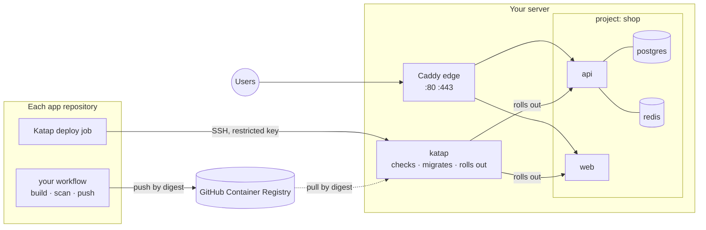

<div align="center">

# Katap

## Many projects. One server. Deployed safely.

You give Katap an image; Katap runs it on your server,<br>
next to your other projects, behind one HTTPS edge.

[](https://github.com/jaylordibe/katap/actions/workflows/test.yml)
[](https://github.com/jaylordibe/katap/releases/latest)


[](LICENSE)

NestJS · Laravel · Angular · React · Vue · Next.js

**[Why&nbsp;Katap](#why-katap)** · **[Before&nbsp;you&nbsp;start](#before-you-start)** ·
**[Quick&nbsp;start](#quick-start)** · **[How&nbsp;it&nbsp;works](#how-it-works)** ·
**[Security](#security-in-short)** · **[Docs](#documentation)** · **[Development](#development)**

</div>

---

*Katap* is Cebuano for **spreading out**: one server, and your projects spread
across it, each in its own space.

## Why Katap

For a solo developer or a small team on one cheap server. Free on any GitHub
plan, private repositories included.

| Your application repository | Katap, on your server |
|---|---|
| Packages the app with its own `Dockerfile` | Runs it: compose services, PostgreSQL, Redis, HTTPS |
| Builds and pushes the image in its own GitHub Actions | Health checks, migrations, automatic rollback |
| Ends its workflow with one Katap deploy step | Nightly database dumps, and restore |
| Holds no deployment files | Each component's settings and secrets |

Several projects share the server, each with its own database, Redis and
network. Only the edge (Caddy) is reachable from the internet.

## Before you start

- **A server:** Ubuntu 24.04 or Debian 12, x86-64, with a public, static IPv4 address. A 4 GB server holds two or three small projects ([sizing](docs/operations.md#is-one-server-enough)).
- **SSH access** to it as `root`, or as a user with `sudo` ([Server access and identity](docs/server-access.md)). SSH must listen on port 22.
- **Its cloud firewall** allows 22, 80 and 443: port 22 also for GitHub Actions, which deploys over SSH.
- **A domain** whose DNS you can edit.
- **Each application** in a GitHub repository, with a `Dockerfile`. The APIs from [nestjs-api](https://github.com/jaylordibe/nestjs-api) and [laravel-api](https://github.com/jaylordibe/laravel-api) have one. For a frontend, see [Packaging the application](docs/deploying.md#1-package-the-application).

## Quick start

| Step | Where | What you do |
|---|---|---|
| [1](#1-install) | Server | Install Katap |
| [2](#2-describe-your-projects) | Server | Describe your projects, then `katap apply` |
| [3](#3-fill-in-the-settings) | Server | Fill in each component's settings |
| [4](#4-point-dns-at-the-server) | DNS provider | Point your domains at the server |
| [5](#5-make-the-deploy-keys) | Server, then GitHub | `katap deploy-key`, then add the secrets and variables it prints |
| [6](#6-add-the-workflow-and-push) | Each repository | Add the workflow, if it hasn't one, and push to `main` |

### 1. Install

*On the server:*

```bash
curl -fsSL https://raw.githubusercontent.com/jaylordibe/katap/main/install.sh | sudo bash
```

It installs Docker, the firewall, swap, a `deploy` user, nightly backups, the
shared Caddy edge and the `katap` command. It asks nothing. It ends with
`provision: done. Next:`.

### 2. Describe your projects

*On the server:* list your projects in one file.

```bash
sudo nano /srv/katap.json
```

```json
{
  "host": "203.0.113.10",
  "projects": {
    "shop": {
      "api": { "type": "nestjs-api", "repo": "your-org/shop-api", "domains": ["api.example.com"] },
      "web": { "type": "node-ssr",   "repo": "your-org/shop-web", "domains": ["example.com", "www.example.com"] }
    }
  }
}
```

- `host`: the server's public IPv4 address.
- `type`: `nestjs-api`, `laravel-api`, `spa` (Angular, React, Vue) or `node-ssr` (Next.js).
- `repo`: the GitHub repository whose image this component runs.

Then:

```bash
katap apply
```

It shows what it will create and asks before writing anything. Then it prints
the DNS records to add and the settings to fill in. Every key is in
[The projects file](docs/projects-file.md).

### 3. Fill in the settings

*On the server,* for each component:

```bash
katap env shop api
```

Passwords and keys are already generated. Fill in what only you know, such as
mail or storage settings. A deploy is refused while a required value is empty,
and says which. What each template needs is in
[Application settings](docs/projects-file.md#application-settings).

### 4. Point DNS at the server

*At your DNS provider:* add the A records `katap apply` printed, one per domain,
all pointing at the server's IPv4 address. No AAAA records.

Using Cloudflare's proxy (orange cloud)? Also run `katap edge cloudflare` on the
server: see [Cloudflare mode](docs/reference.md#cloudflare-mode).

### 5. Make the deploy keys

*On the server,* for each component:

```bash
katap deploy-key shop api
```

It makes a key that can deploy `shop/api` and nothing else, and prints what to
add to that component's repository. *In GitHub:* **Settings → Secrets and
variables → Actions**:

| Tab | Name | Value |
|---|---|---|
| Secrets | `KATAP_SSH_KEY` | The private key it printed, every line |
| Secrets | `KATAP_HOST` | The server's address |
| Secrets | `KATAP_KNOWN_HOSTS` | The server's host key line |
| Variables | `KATAP_PROJECT`, `KATAP_COMPONENT` | `shop`, `api` |

The private key is shown once and isn't kept on the server. A staging
component's are named `KATAP_STAGING_…`.

### 6. Add the workflow and push

*In each repository:*
- **Made from [laravel-api](https://github.com/jaylordibe/laravel-api) or [nestjs-api](https://github.com/jaylordibe/nestjs-api)?** It already builds in `publish-image.yml`. Paste the two deploy jobs from [`examples/github-workflow.yml`](examples/github-workflow.yml) at its end, as they are (a nestjs-api uncomments their `migrate-image` line), and set the repository variable `PUBLISH_ENABLED` to `true`. A copy made before the starter's `publish` job had `outputs:` takes those lines from the starter too.
- **Any other repository:** copy [`examples/github-workflow.yml`](examples/github-workflow.yml) to `.github/workflows/`, unchanged. It's GitHub's standard build-and-push, plus the Katap deploy jobs.

More detail, and a repository that already builds its image another way: [The workflow](docs/deploying.md#2-the-workflow).

Push to `main`. The workflow builds, scans and pushes the image, and Katap
deploys it:
- if a required setting is still empty, the deploy is refused and names it;
- if the new release fails its health check, the previous one comes back automatically.

**First deploy only:** create your first admin user. See
[First deploy](docs/deploying.md#first-deploy).

> [!TIP]
> **Adding a project later:** add it to `/srv/katap.json`, then repeat steps 2 to 6
> for it. A component created by mistake, and never deployed: delete it from
> `/srv/katap.json`, then `katap remove <project> <component> --confirm <project>`.

## How it works



A **deploy:**
1. checks the component's settings;
2. pulls the image, unless it's already on the server;
3. dumps the database;
4. runs the migrations;
5. recreates the services and waits for their health checks;
6. checks the app answers.

If the new release never becomes healthy, the previous images come back
automatically. Migrations are not undone, so keep them backward compatible:
[What a deploy does](docs/operations.md#what-a-deploy-does).

## The SSH keys involved

| Key | Who holds it | What it can do |
|---|---|---|
| **Your administrator key** | Your computer | Log in to install and run `katap`. Full control of the server |
| **Deploy keys** | GitHub, as a repository's `KATAP_SSH_KEY` secret | Made by `katap deploy-key`. Deploy or roll back one component, nothing else |
| **The server's host key** | The server; pinned in `KATAP_KNOWN_HOSTS` | Proves to GitHub Actions that it's talking to your server |

Never put your administrator key in GitHub. How to log in with a non-default key
and check the host key: [Server access and identity](docs/server-access.md).

## Security in short

- **Only the edge is reachable.** Databases and Redis never leave their project's network.
- **Secrets are generated on the server,** once, mode 0600. They're never in git, nor in `katap.json`.
- **A deploy key deploys one component.** It can't open a shell or touch another project.
- **No GitHub credential is stored on the server.** A deploy pulls a private image with its own GitHub Actions token, which expires with the job.
- **Katap automates nothing destructive:** it never drops volumes or regenerates keys. Your application's own forward migrations do run on every deploy.

The full model, and what it doesn't protect against: [Security model](docs/security.md).

## Documentation

| Topic | |
|---|---|
| [Deploying from GitHub Actions](docs/deploying.md) | Packaging, the workflow, deploy keys, staging, first deploy |
| [The projects file](docs/projects-file.md) | `katap.json`, `katap apply`, settings, removing a mistake |
| [Day to day](docs/operations.md) | Rollback, backups, restore, logs, sizing, upgrading PostgreSQL |
| [Reference](docs/reference.md) | Commands, layout, templates, DNS, TLS and Cloudflare mode |
| [Server access and identity](docs/server-access.md) | Administrator SSH, host-key verification, sudo |
| [Security model](docs/security.md) | What each control protects, and the known limits |
| [Updating Katap](docs/updating.md) | Upgrading the server, moving the deploy step's pin, v1 to v2 |
| [Troubleshooting](docs/troubleshooting.md) | Each refusal, its cause, what to check |
| [Running on Google Cloud](docs/gcp.md) | Firewall rules, SSH with OS Login, IAP |

## Development

```bash
tests/run.sh          # static and unit tests, in a pinned Linux container
E2E=1 tests/run.sh    # plus a real deploy on local Docker
```

Issues and pull requests are welcome. Run `tests/run.sh` before opening a pull
request, and `E2E=1 tests/run.sh` for anything that changes a deploy.

---

<div align="center">

**Your projects, spread across one server — each in its own space.**

MIT licensed · see [LICENSE](LICENSE)

</div>
